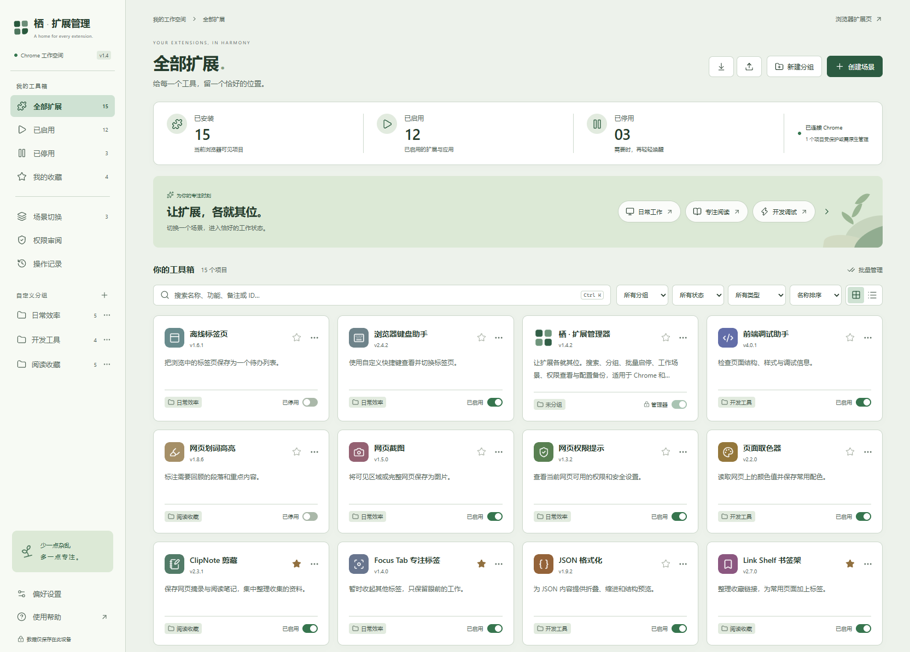
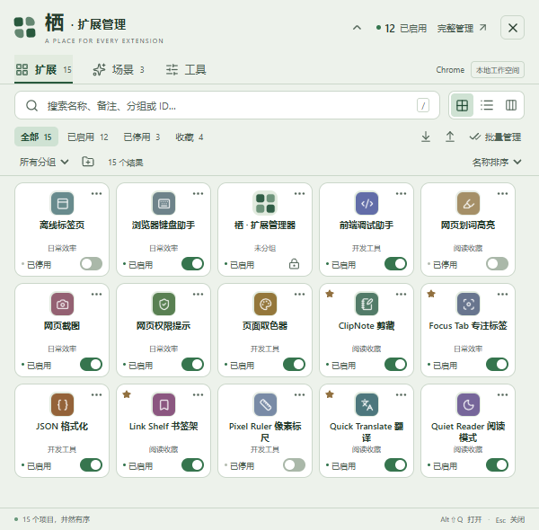

# 栖 · 扩展管理器

让扩展各就其位。一个面向 Chrome 和 Microsoft Edge 桌面版的 Manifest V3 扩展管理器，提供工具栏快捷面板和完整管理页。

目标运行环境为 Chromium 114 及以上的 Chrome / Edge 桌面版。两个浏览器使用同一份构建产物，分别安装、分别管理各自当前用户资料中的扩展。版本目标不代表所有 Chrome / Edge 版本都经过实机测试；验证记录见项目交付说明。

## 安装

### 使用发布压缩包

[下载 v1.4.2 安装 ZIP](https://github.com/liuqingwlil/qii-extension-manager/releases/download/v1.4.2/qii-extension-manager-1.4.2.zip)

**Chrome 和 Edge 共用同一个 ZIP。** 将 ZIP 解压到固定目录，在两个浏览器的扩展管理页分别加载直接包含 `manifest.json` 的目录。安装后请保留该目录，浏览器会继续从中读取扩展文件。

### 使用源码构建

需要已安装 Node.js 与 npm，并使用满足 Vite 要求的 Node.js 版本。

```powershell
git clone https://github.com/liuqingwlil/qii-extension-manager.git
cd qii-extension-manager
npm install
npm run build
```

构建成功后，从项目目录下的 `dist` 安装扩展。

### 在 Chrome 中加载

1. 地址栏输入 `chrome://extensions`。
2. 打开“开发者模式”。
3. 点击“加载已解压的扩展程序”，选择上述 `dist` 或发布包中直接包含 `manifest.json` 的目录。
4. 在工具栏的扩展菜单中固定“栖 · 扩展管理器”。

### 在 Edge 中加载

1. 地址栏输入 `edge://extensions`。
2. 打开“开发人员模式”。
3. 点击“加载解压缩的扩展”，选择上述 `dist` 或发布包中直接包含 `manifest.json` 的目录。
4. 在工具栏的扩展菜单中显示“栖 · 扩展管理器”。

安装时的“管理您的应用、扩展程序和主题背景”权限提示来自核心 `management` 权限。它用于读取扩展清单、启停扩展和发起卸载；另外只声明 `storage` 用于保存本地配置。

## 界面截图

截图来自 v1.4.2 的实际扩展界面，使用独立浏览器资料中的示例扩展。

### 完整管理页



### 工具栏快捷小窗



## 使用

- **快捷小窗**：点击工具栏图标或 `Alt+Shift+Q` 打开 600px 宽的原生浏览器小窗。点击网页其他位置自动收起，也可点右上角关闭；`Esc` 先返回上层，再关闭小窗。
- **小窗中的扩展管理**：支持图标网格 / 列表、舒适 / 紧凑密度、名称及备注搜索、启用 / 停用 / 收藏筛选、分组筛选，以及批量启停和移动分组。600×590 下普通网格完整显示 15 项、紧凑网格 24 项，可收起人物页头继续增加空间。成功反馈位于固定页脚，开关操作保持列表位置；小窗布局偏好独立保存。
- **小窗中的详情与场景**：直接管理收藏、分组、备注和权限详情；在场景页保存、编辑、删除扩展组合，切换前查看变化；工具页提供主题、备份和原生设置入口。
- **皮肤替换**：小窗“工具”或管理页“偏好设置”中的“皮肤外观”支持森林序曲、爱莉希雅。皮肤与浅色 / 深色 / 跟随系统独立搭配，同步到管理页和小窗，并随配置备份保存。
- **爱莉希雅花庭**：小窗设有独立立绘展示区，花瓣和切面水晶作为页头与边缘背景。扩展卡片保持实色表面，装饰不接收点击；窄窗口会缩小页头与立绘，保留内部滚动及关闭入口。
- **更清楚的状态**：强化控件与文字对比，选中使用更明显的底色、勾选与“已选中”文字；鼠标操作和键盘焦点分别反馈。停用扩展继续保留容易辨认的原图标颜色。
- **完整管理页**：通过快捷面板、扩展选项页或 `Alt+Shift+E` 打开。快捷键被其他软件占用时，可到 `chrome://extensions/shortcuts` 或 `edge://extensions/shortcuts` 调整。
- **查找与整理**：按名称、扩展 ID 等内容搜索，结合状态、分组、收藏和排序快速定位；为扩展分配分组、添加收藏和个人备注。
- **查看与操作**：查看版本、来源、权限和网站访问范围；在支持时打开扩展设置页、主页及浏览器原生详情。无法修改的项目会保留状态说明与原生入口。
- **批量启停**：选择多个项目后统一启用或停用。操作会保留本管理器并遵守浏览器限制；结果区会说明成功、跳过和失败的项目。
- **工作场景**：保存一组扩展启停状态，切换前查看变更预览，确认后执行并查看逐项结果。场景不会安装缺失扩展，也无法越过组织策略或重新授权提示。
- **权限审阅**：集中查看扩展声明的 API 权限与网站权限。审阅依据是浏览器暴露的权限信息，不是恶意软件检测，也不能证明某个扩展安全或危险。
- **配置与清单 JSON 备份**：一键导出全部可见扩展的 ID、名称、版本、来源和启用状态，以及分组、收藏、备注、场景与皮肤。导入先显示预览，确认后应用已安装扩展的状态并核验实际结果；缺失、受保护或需授权的项目单独说明，可重新检查并再次应用。
- **扩展文件 ZIP 迁移**：Windows 配套助手打包商店扩展和本地目录，逐文件 SHA-256 校验；新电脑一次解包到新目录并生成安装清单。文件恢复不会静默安装扩展，仍需完成浏览器安装确认。导入、导出按钮在同一区域相邻排列。
- **配置迁移**：原有“导出配置 / 导入配置”继续只迁移管理器配置，不改变扩展启用状态。恢复结果单独保存在本地，可在“上次恢复记录”中查看并下载报告。
- **外观与记录**：切换三种主题和栅格 / 列表视图；在活动记录中查看管理操作。

扩展卸载必须由浏览器的原生确认窗口批准。因更新增加权限而停用的扩展，可能需要单项点击并重新授权。只读项目、主题和旧应用等特殊类型以界面实际可用操作为准。

## 备份包含什么

JSON 备份（version 2）包含管理配置与全部扩展清单；清单包含扩展 ID、名称、版本、类型、安装来源、启用状态及可获得的来源链接，另记录来源浏览器与管理器 ID。原配置备份（version 1）的清单只包含 ID、名称与启用状态，两种格式均可读取，并通过明确选择决定是否应用启停状态。

JSON **不包含扩展代码**。新增 Windows ZIP 迁移助手可以一起备份实际扩展目录，包括本地开发扩展，详见 [文件迁移](docs/MIGRATION.md)。ZIP 和 JSON 均不包含其他扩展的私有存储、密码或登录状态。缺失扩展不能静默安装；可打开官方商店入口，由用户安装后重新检查。开发者模式扩展需重新加载原本的本地项目。不同商店中的同类扩展可能拥有不同 ID，不会仅凭同名自动将它们对应起来。

扩展清单和备注可能反映你的工作习惯。请自行保管导出的文件，导入他人提供的配置前查看内容。

## 开发与验证

```powershell
npm install
npm run dev
npm run build
npm run test
npm run test:e2e
npm run test:popup
npm run test:skin
npm run test:skin-art
npm run test:restore
npm run package
```

- `dev`：启动本地 HTTP 预览。普通网页没有 `chrome.management` 权限，只能使用明确标记的示例演示数据。
- `build`：运行 TypeScript 检查并生成可加载的 `dist`。
- `test`：运行核心逻辑的自动化测试。
- `test:e2e`：运行浏览器交互验证；首次运行前需要可供 Playwright 使用的浏览器环境，具体以脚本输出为准。
- `test:popup`：验证多功能小窗的交互、状态持久化与布局，并输出截图和报告。
- `test:popup-stability`：验证启停过程中的滚动、卡片与图标节点稳定性、提示自动消失、并发状态及小窗显示容量。
- `test:skin`：验证皮肤同步与持久化、旧备份兼容、键盘操作、选中状态以及本地图片资源，并输出主题截图。
- `test:skin-art`：验证立绘裁切、装饰层级、文字图标可见性和点击命中，以及不同布局和小窗口适配。
- `test:restore`：使用独立 MV3 环境验证全量导出、恢复预览、真实启停、范围保护、部分失败与持久报告。
- `test:migration-ui`：验证文件迁移入口、相邻按钮、完整清单请求、部分失败与待安装提示；本地助手响应仅在隔离渲染器模拟。
- `test:migration-helper`：用临时资料验证真实文件打包、恢复、哈希、安全路径与原生消息协议。
- `package`：将构建产物整理为可分发压缩包；以命令输出的文件路径为准。

真实扩展模式与 HTTP 演示模式明确区分。扩展 API 读取失败时会显示错误，不会悄悄改用示例数据。修改源码后重新执行 `npm run build`，再到浏览器扩展页点击本管理器的“重新加载”。

首次运行集成测试前执行 `npx playwright install chromium`。完整测试使用 Playwright 自带 Chromium 的独立资料，管理专用测试扩展，不使用日常浏览器资料。验证结果及范围见 [交付验证](docs/VALIDATION.md)。

`npm run package` 生成 `release/qii-extension-manager-1.4.2.zip`（安装包）和 `release/qii-extension-manager-1.4.2-source.zip`（源码包）。设计参考图和 ImageGen 提示词分别位于 `docs/design-reference.png` 与 `docs/design-prompt.txt`。爱莉希雅插画位于 `public/skins/elysia.png`，完整生成提示词在 `docs/elysia-skin-prompt.txt`。花瓣、水晶背景为本地可编辑 SVG：`public/skins/elysia-garden.svg`。

从 1.0.0 / 1.1.0 更新时，在原位置覆盖文件后到浏览器扩展页点击“重新加载”，即可保留同一扩展 ID 下的配置。若改用不同目录加载，浏览器可能生成不同 ID；请先导出配置，并在新安装后导入。旧版配置备份仍可导入，未保存皮肤选项时默认使用森林序曲。

## 隐私与能力边界

配置保存在当前浏览器的本地存储中。项目不接入分析、广告或外部追踪服务，不读取网页内容、Cookie 或浏览历史，也不通过网络请求获取这些数据。主动点击商店或扩展主页会打开相应外部页面。

“支持所有扩展”指支持当前浏览器 API 返回的扩展清单和通用管理能力；组织强制安装、浏览器保护或已不再受浏览器支持的项目不能绕过限制。请参阅 [隐私说明](docs/PRIVACY.md) 与 [API 能力及限制](docs/API-LIMITS.md)。

官方参考：[Chrome management API](https://developer.chrome.com/docs/extensions/reference/api/management)、[Edge 支持的扩展 API](https://learn.microsoft.com/en-us/microsoft-edge/extensions/developer-guide/api-support)。
